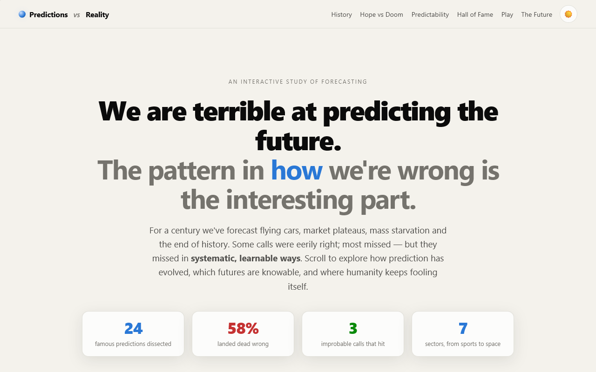
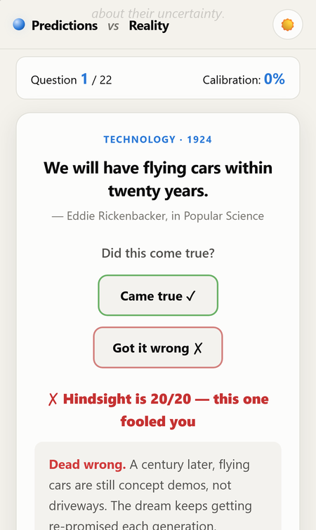
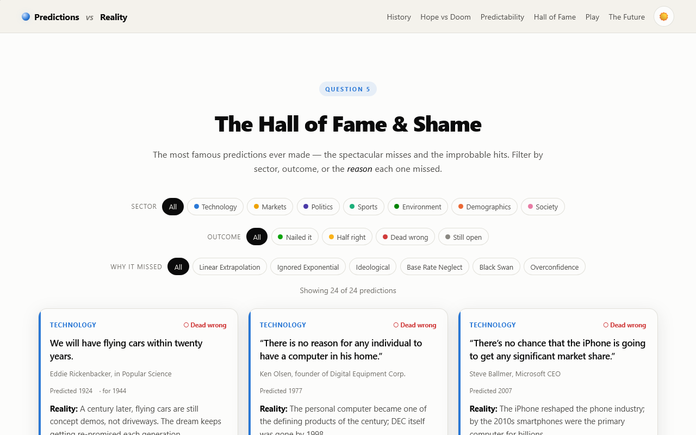

# Predictions vs Reality

An interactive essay on forecasting: how humanity's famous predictions compared with what actually happened, and the patterns in *how* we get the future wrong.

**[▶ Open the live app](https://timothyhadfield.github.io/predictions-vs-reality/)** · works on phone and laptop

  
  &nbsp;
  

  

## Features
- **Hall of Fame & Shame**: 24 famous predictions (flying cars, "Dow 36,000", Leicester at 5000-to-1…), each with what really happened and a source, filterable by sector, outcome and *why it missed*
- **Think you'd have called it?**: a predict-first game. Guess whether each prediction came true before the reveal, with a running calibration score
- **The evolving crystal ball**: a timeline of six forecasting eras, from oracles to machine forecasting
- **Hope vs Doom**: a chart of which sectors we're too optimistic about and which we catastrophize, computed from the dataset
- **Predictability spectrum**: from clockwork (eclipses) to black swans (markets, geopolitics), with the reason each domain sits where it does
- **Forecast horizon**: today's best forecasts for 2050 and 2100, each with a confidence level
- **Sourced**: every claim links to a reference; the written analysis lives in [RESEARCH.md](RESEARCH.md)
- **Light and dark themes**

## Built with
Plain HTML, CSS and JavaScript, no frameworks or build step. The data lives in `data/*.js`.
